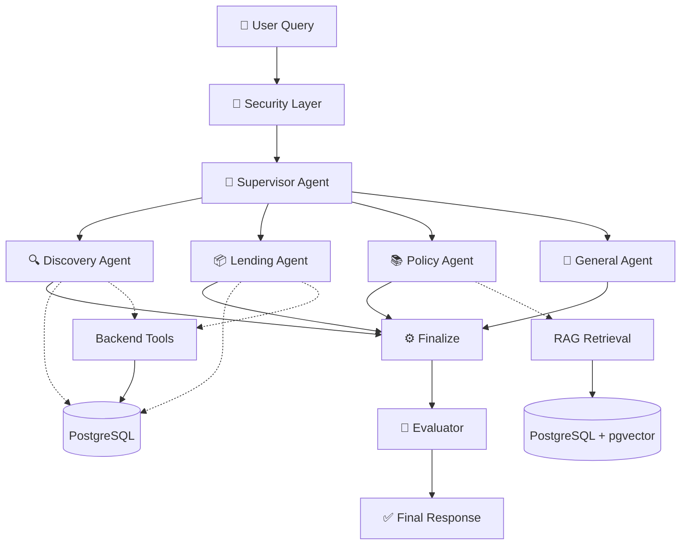
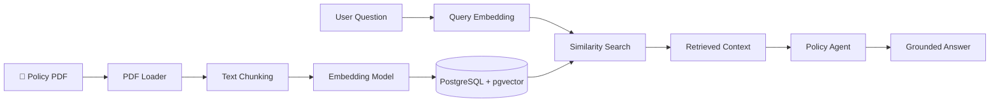

# <p align="center">🤖 CampusLoop AI</p>
### <p align="center">AI-Powered Campus Borrowing Platform | Multi-Agent AI System</p>

<p align="center">
  <strong>Discover. Borrow. Share. Simplify.</strong>
</p>

<p align="center">
  A smart campus marketplace powered by a Supervisor-Based Multi-Agent AI System, RAG, and LLM Tool Calling.
</p>

---

## Overview

CampusLoop AI is a full-stack campus borrowing platform that allows students to discover, borrow, and lend essential items within their institute.

It integrates a **Multi-Agent AI Assistant** that understands natural-language queries, retrieves marketplace information, assists with borrowing operations, and answers campus policy questions using RAG.

## ✨ Key Features

- 🛍️ **Smart Marketplace** — Discover available campus items with complete details.
- 🔄 **Borrowing Management** — Send, approve, and reject borrowing requests.
- 📦 **My Listings** — Create, edit, and manage personal listings.
- 🤖 **Multi-Agent AI Assistant** — Supervisor-based intelligent query routing.
- 📚 **RAG-Based Policy Assistant** — Answers grounded in uploaded policy documents.
- 🔔 **Smart Notifications** — Borrowing updates and unread notification tracking.
- 🖼️ **Image Upload** — Supabase Storage integration.
- 🔐 **Secure Authentication** — JWT-based authentication and authorization.

---

## 🧠 Multi-Agent Architecture

CampusLoop AI uses **Langchain** and **LangGraph** to coordinate specialized agents through a supervisor-based architecture.



### Agent Responsibilities

| Agent | Responsibility |
|---|---|
| 🧠 Supervisor | Understands intent and selects a specialist |
| 🔍 Discovery | Searches available items and marketplace listings |
| 📦 Lending | Handles borrowing-related operations |
| 📚 Policy | Retrieves policy context using RAG |
| 💬 General | Handles general platform queries |
| 🧪 Evaluator | Evaluates the generated response |

**Execution Flow:** Security → Supervisor → Selected Specialist → Finalize → Evaluator → Response.

---

## 📚 RAG Pipeline

The Policy Agent uses Retrieval-Augmented Generation to answer questions from the campus policy PDF.




---

## 🏗️ Technology Stack

| Layer | Technologies |
|---|---|
| Frontend | React.js, Vite, Tailwind CSS |
| Backend | Python, FastAPI, SQLAlchemy |
| Multi-Agent AI | LangGraph, LangChain, LLM API |
| RAG | Sentence Transformers, PyPDFLoader |
| Database | PostgreSQL, pgvector |
| Storage | Supabase Storage |
| Authentication | JWT |
| Development | Git, GitHub, Pytest |

---

## 📁 Project Structure

```text
CampusLoop-AI/
│
├── frontend/
│   ├── public/
│   ├── src/
│   │   ├── assets/
│   │   ├── components/
│   │   ├── pages/
│   │   ├── context/
│   │   ├── services/
│   │   ├── App.jsx
│   │   └── main.jsx
│   ├── package.json
│   └── vite.config.js
│
├── backend/
│   ├── agents/
│   │   ├── Agents.py
│   │   ├── Graph.py
│   │   ├── State.py
│   │   ├── tools.py
│   │   └── rag.py
│   │
│   ├── database/
│   │   ├── connection.py
│   │   └── models.py
│   │
│   ├── knowledge_base/
│   │   └── campusloop_policy.pdf
│   │
│   ├── config.py
│   ├── main.py
│   ├── requirements.txt
│   └── .env
│
├── .gitignore
└── README.md
```

---

## ⚙️ Installation & Setup

### Prerequisites

- Python 3.10+
- Node.js and npm
- PostgreSQL with pgvector
- Groq API Key
- Supabase Project

### 1. Clone Repository

```bash
git clone YOUR_GITHUB_REPOSITORY_URL
cd CampusLoop-AI
```

### 2. Backend Setup

```bash
cd backend

python -m venv venv

# Windows
venv\Scripts\activate

# Install dependencies
pip install -r requirements.txt
```

### 4. Database Setup

Create the PostgreSQL database:

```sql
CREATE DATABASE campusloop;
```

Enable pgvector:

```sql
CREATE EXTENSION IF NOT EXISTS vector;
```

Run your project's database initialization or migrations before starting the application.

### 5. Start Backend

From the `backend` directory:

```bash
uvicorn main:app --reload
```

Backend: `http://127.0.0.1:8000`

API Documentation: `http://127.0.0.1:8000/docs`

### 6. Frontend Setup

Open a new terminal:

```bash
cd frontend

npm install

npm run dev
```

Frontend: `http://localhost:5173`

---

## 💬 AI Assistant Examples

```text
🔍 Show me all currently available items.

📦 I want to borrow the HP Laptop Charger.

📋 Show my pending borrowing requests.

📚 Explain the campus borrowing policy.

🔔 Show my unread notifications.

⚙️ Mark all my notifications as read.
```

The assistant routes requests to the appropriate specialist and uses authorized backend tools for supported operations.

---

## 🔐 Security

- JWT-based user authentication.
- Server-side authorization for protected operations.
- User ownership verification before database mutations.
- Secure API key management through environment variables.
- Restricted access to Supabase credentials.
- RAG-based policy answers grounded in retrieved context.

---

## 🧪 Testing

Run backend tests:

```bash
pytest -v
```

Test important workflows:

- Agent routing and specialist selection.
- Marketplace item discovery.
- Borrowing request creation.
- Owner and borrower authorization.
- Policy retrieval and answer grounding.
- Notification access and read status.

---

## 🚀 Future Enhancements

- Human-in-the-loop approval workflows.
- Automated return request management.
- Improved agent memory and conversation persistence.
- Agent execution tracing and observability.
- Advanced RAG evaluation.
- Docker-based deployment.

---

## 👨‍💻 Author

**Shivam Sharma**

B.Tech — Computer Science and Engineering  
Madhav Institute of Technology & Science (MITS), Gwalior

**Project:** CampusLoop AI — Multi-Agent Campus Borrowing Platform

---

<p align="center">
  <strong>Built to make campus resource sharing smarter.</strong>
</p>
